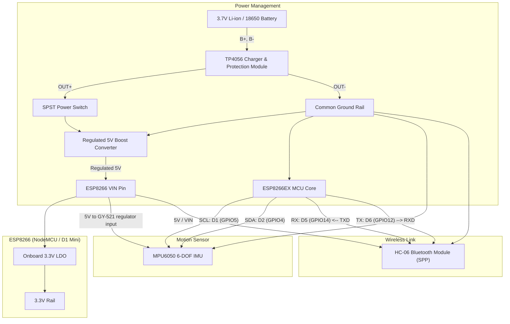

# ESP8266 + MPU6050 + HC-06 Air Mouse: Complete Wiring & Hardware Architecture

This document records the pinout and intended power circuit. The earlier handover reported USB-powered sensor operation; battery operation and the exact board variants still require physical verification.

---

## 1. System Block Diagram



---

## 2. Complete Pinout & Wiring Table

| Peripheral | Module Pin | ESP8266 Pin | ESP8266 GPIO | Electrical Details & Critical Rules |
| :--- | :--- | :--- | :--- | :--- |
| **MPU6050** | **VCC** | **Regulated 5V / VIN** | — | For the reported GY-521 breakout with onboard regulator. A bare MPU6050 must not receive 5V; check the actual breakout. |
| | **GND** | **GND** | — | Connect to system common ground. |
| | **SCL** | **D1** | `GPIO5` | Hardware I2C Clock (100 kHz standard mode). |
| | **SDA** | **D2** | `GPIO4` | Hardware I2C Data. |
| | **AD0** | **GND** | — | Hardwires I2C slave address to `0x68`. |
| | **INT** | *Not Connected*| — | Polling mode used at 50 Hz in firmware. |
| **HC-06 Bluetooth** | **VCC** | **Regulated 5V / VIN** | — | For the reported HC-06 carrier with a 3.3V regulator. Confirm its input rating; do not apply 5V to a bare 3.3V radio module. |
| | **GND** | **GND** | — | Connect to system common ground. |
| | **TXD** | **D5** | `GPIO14` | ESP SoftwareSerial **RX** (Receives from HC-06). |
| | **RXD** | **D6** | `GPIO12` | ESP SoftwareSerial **TX** (Transmits to HC-06). |
| | **STATE** | *Not Connected*| — | Unconnected (optional LED/status tap). |
| | **EN / KEY**| *Not Connected*| — | Unconnected (HC-06 has no key logic). |
| **Unused** | No connection | **D7** | `GPIO13` | No button fitted or read by firmware. |
| **Unused** | No connection | **D3** | `GPIO0` | No button fitted or read by firmware; leave the board's boot pull-up intact. |

Motion control is always active after successful startup calibration. No activation or click buttons are required. Packets retain `dx,dy,0,0` so the existing Windows receiver remains compatible; the device currently controls cursor movement only.

**Verified UART speed for this HC-06: 115200 baud, 8N1.** The Bluetooth baud scan delivered repeated readable 115200-labelled messages; the older 9600-baud setting did not match the module. Both ESP8266 production/test firmware and Python serial defaults now use 115200. This changes signal timing only; the wiring above stays the same.

---

## 3. Critical Hardware & Boot Pin Rules

> [!WARNING]
> **GPIO0 (D3) Boot Hazard:**
> On the ESP8266, `GPIO0` controls boot mode. If held `LOW` during power-on or reset, the chip enters UART flashing mode and will NOT run your sketch. D3/GPIO0 is unused in this version; leave it unconnected and preserve the development board's existing boot pull-up.

> [!IMPORTANT]
> **Power Supply Rail for HC-06 (VIN vs 3.3V):**
> The reported HC-06 carrier has an onboard 3.3V regulator. Feeding that regulator from a 3.3V source leaves insufficient voltage headroom and can cause unreliable operation.
> - Power the supported carrier from a **regulated 5V rail**, after checking its input rating.
> - UART signals remain **3.3V logic**. Do not apply 5V logic to ESP8266 pins.
> - VIN is a pin name, not a guarantee of 5V: a raw battery connected to VIN is still a raw battery supply.

---

## 4. Power Management & Battery Circuit

```
                      ┌──────────────────────────────────────┐
                      │   TP4056 Module (with DW01A/8205A)   │
                      │                                      │
[ 3.7V Li-ion Cell ] ─┤ B+                               OUT+ ├────[ SPST Switch ]──► [ 5V Boost ] ──► VIN / carrier VCC
  (18650 or LiPo)    ─┤ B-                               OUT- ├──────────────────────► ESP8266 GND
                      └──────────────────────────────────────┘
```

1. **Battery:** Single-cell 3.7V Li-ion or LiPo (nominal 3.7V, 4.2V fully charged).
2. **Charging & Protection:** The TP4056 board provides safe CC/CV USB charging, while the DW01A protection IC guards against over-discharge (< 2.8V) and short circuits.
3. **Regulation:** Connect protected `OUT+` through the switch to a **regulated 5V boost converter**, then feed its 5V output to the board's supported VIN/5V input and the supported peripheral carriers. Connect boost input/output ground to the common ground rail. The TP4056 is a charger, not a 5V converter. A single cell falls in voltage during discharge; feeding it directly to VIN does not guarantee the required MCU or HC-06 supply.
4. **Board checks:** Confirm the ESP8266 board, its VIN/5V input rating, the HC-06 carrier rating, and the GY-521 regulator before connecting power. Verify the 5V and 3.3V rails under actual load throughout the intended battery range. Size the boost converter for the measured load and startup peaks.
5. **Charging:** A basic TP4056 board is not a load-sharing power controller. Switch the device off while charging unless a suitable power-path circuit is included. Do not connect independent USB and boosted supplies to the same rail unless the exact board supports that arrangement.

The boost converter is an added hardware requirement in this corrected design; changing this document does not install it on the existing device. Use verified USB power while checking the firmware and wireless link.
